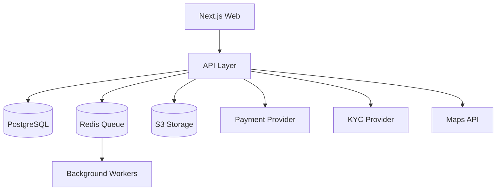

# Teknik Mimari

## Onerilen Stack

- Web: Next.js 15, React 19, TypeScript
- Styling: Tailwind CSS, CSS variables, Radix primitives
- State: TanStack Query + Zustand
- Forms: React Hook Form + Zod
- Backend: Next.js Route Handlers ile MVP; buyuyunce NestJS mikroservisleri
- DB: PostgreSQL
- ORM: Prisma
- Cache/Queue: Redis + BullMQ
- Search: PostgreSQL geospatial + ileride Elasticsearch/Meilisearch
- Maps: Mapbox veya Google Maps
- Object storage: S3 compatible
- Observability: Sentry, OpenTelemetry, structured logs
- Payments: Iyzipay/PayTR/Stripe secimi
- KYC: Onfido/Sumsub veya yerel muadil
- Notifications: email, SMS, push

## Servisler

- Auth service
- User/profile service
- KYC service
- Vehicle service
- Search/availability service
- Booking service
- Payment service
- Inspection service
- Claims/disputes service
- Reviews service
- Admin service
- Notification service

## Kritik Teknik Noktalar

- Uygunluk hesaplama transaction-safe olmali; ayni arac ayni zaman araliginda iki kez rezerve edilememeli.
- Odeme provizyonu rezervasyon onayindan once alinmali, capture kiralama baslangicina yakin yapilandirilabilir.
- Fotografli check-in/check-out zorunlu olmali.
- Kimlik, ehliyet ve odeme yontemi ayni kisiye ait olmali.
- Arac konumu tam adres yerine kiralama onayi sonrasi hassaslasmali.
- Admin tarafinda tum kritik aksiyonlar audit log'a yazilmali.

## Basit Sistem Diyagrami



## Monorepo Onerisi

```text
apps/
  web/
  admin/
  api/
packages/
  ui/
  config/
  database/
  validators/
  integrations/
```

